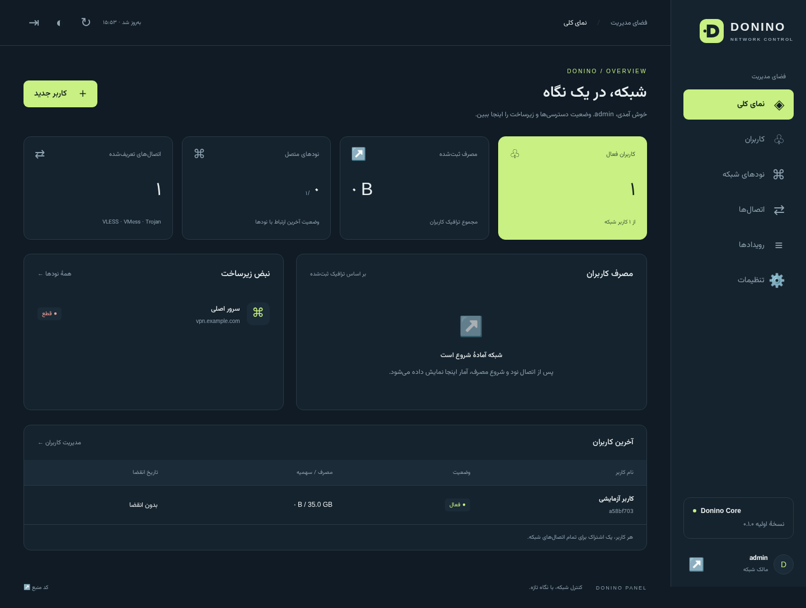
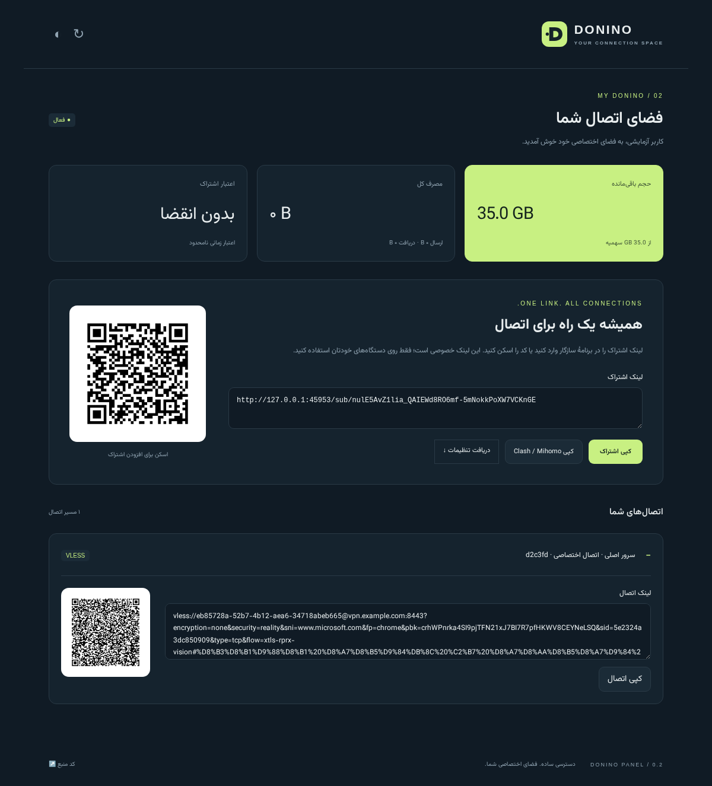

<div align="center">


# Donino Panel

**شبکهٔ تو. قواعد تو.**

پنل مستقل مدیریت Xray با رابط فارسی، معماری چند نود و هویت اختصاصی دونینو.

**نسخهٔ ۱.۰.۰ — انتشار نصب‌شدنی با امکانات فعلی.**

[شروع و ارتقا به v1](docs/V1.fa.md) · [دامنهٔ انتشار و محدودیت‌ها](docs/V1.fa.md#دامنهٔ-انتشار)

[Shadowsocks و 2022](docs/SHADOWSOCKS.fa.md) با پنج روش AEAD، رمز مستقل دستگاه، خروجی URI/Mihomo و انتقال واقعی TCP/UDP اضافه شد. تغییر کاربران روی نود دارای این نقش فعلاً با restart هسته انجام می‌شود.

[OpenVPN UDP/TCP](docs/OPENVPN.fa.md) با گواهی مستقل دستگاه، خروجی خصوصی ovpn، حجم/دوره/انقضا و قطع نشست اضافه شده است. نصب نقش نود فعلاً دستی است؛ پذیرش شبکهٔ آزمایشگاهی جای آزمون VPS و شبکهٔ واقعی را نمی‌گیرد.

[پایش اختیاری تانل](docs/TUNNEL-BRIDGE.fa.md#پایش-اختیاری-و-تمدید-خودکار--alpha-13) با کلاینت واقعی، تمدید محدود آدرس، قطع انتشار هنگام خرابی و بازیابی همان مسیر اضافه شد. نصب اولیهٔ نقش‌ها و پذیرش دو VPS واقعی همچنان لازم‌اند.

[نصب مستقل نود خروجی](docs/SMART-EXIT-INSTALL.fa.md) با `--role smart-exit` اضافه شده است: بدون دیتابیس اضافی، credential خصوصی پایدار، TLS/ACME، تمدید و سرویس مستقل.

[Smart DNS و مسیریابی خروجی](docs/SMART-DNS.fa.md): relay واقعی HTTPS با TLS دست‌نخورده، خروجی اصلی و دو جایگزین، کنترل IP و انقضا، حجم مستقل و حالت تخلیه. نصب اختیاری با اشتراک IP و پورت ۴۴۳ پنل؛ پذیرش بازی‌ها و اینترنت واقعی هنوز لازم است.

[تانل خودکار آزمایشی](docs/TUNNEL-BRIDGE.fa.md): جفت‌سازی، پیش‌نمایش، نصب دوطرفه و پیگیری عملیات از طریق Donino Tunnel محلی. نقشه‌ها به نود/ورودی‌های پنل متصل و با محافظت در برابر تغییر تنظیمات و بازیابی پاسخ گم‌شده ثبت می‌شوند. آزمون واقعی شش مسیر TLS، انتشار تأییدشدهٔ آدرس اضافه با lease ۲۴ ساعته و لغو انتشار افزوده شده‌اند. آماده‌سازی اولیهٔ دو نقش لازم است؛ این نسخه TCP روی FRP WSS/QUIC را عرضه می‌کند و مبدأ اشتراک را جایگزین نمی‌کند. [CLAUDE.md](CLAUDE.md) و [دفتر همکاری](docs/coordination/README.fa.md) مأموریت و نقطهٔ ادامهٔ کلاد را برای پیام «ادامه» نگه می‌دارند.

[کاتالوگ و انتقال مرحله‌ای doctor-dns](docs/DOCTOR-DNS-IMPORT.fa.md) اضافه شده‌اند: انتخاب ۴۲ سرویس/۴۸ گروه برای ساخت سیاست، و انتقال قابل بازگشت حساب‌ها با حفظ حجم و تاریخ مبدأ. حساب‌های منتقل‌شده تا تطبیق خدمت غیرفعال می‌مانند. [کار فعال Codex](docs/coordination/tasks/codex-v1-progress.fa.md) و نقطهٔ ادامه ثبت شده‌اند؛ کلاد فعلاً به دستور کاربر متوقف است.

[DNS اختصاصی آزمایشی](docs/DNS-PREVIEW.fa.md) اکنون شامل UDP/TCP، DoT و DoH احرازشده، سیاست دامنه، سهمیهٔ مستقل درخواست و ثبت IP اثبات‌شده است. نصب اختیاری `--with-dns` از Unbound واقعی استفاده می‌کند. Smart DNS برای HTTPS منتخب افزوده شده است؛ DoQ و مسیر UDP بازی هنوز آماده نیستند.

نسخهٔ جدید، [بودجهٔ مشترک آزمایشی](docs/SHARED-QUOTA.fa.md) را برای کاربران تازه و عامل‌های امن اضافه می‌کند: اعتبار گزارش‌نشدهٔ نود قطع‌شده دوباره تخصیص نمی‌یابد و عامل، پایان بودجه را مستقل از اتصال پنل بررسی می‌کند. حدود نمونه‌برداری و روش رسیدگی به ذخیرهٔ نامعلوم در همان راهنما آمده‌اند.

[راهنمای راه‌اندازی](docs/DEPLOYMENT.fa.md) · [ارتقا از ۰.۱](docs/UPGRADE-0.2.fa.md) · [تغییرات نسخه‌ها](CHANGELOG.md) · [برنامهٔ جامع ۱.۰](docs/MASTER-PLAN.fa.md) · [وضعیت امکانات](docs/ROADMAP.fa.md) · [Architecture](docs/ARCHITECTURE.md)

</div>



تصویر از اجرای واقعی رابط با داده‌های آزمایشی است؛ سرور نمونهٔ تصویر، نود عملیاتی نیست.

پیش‌نمایش جدید روی آخرین تغییرات `main` ادامه یافته است: امنیت حساب و MFA رمزگذاری‌شده، دستگاه‌ها، PostgreSQL، نصب خودکار کنترل‌پنل با HTTPS، پشتیبان کامل رمزگذاری‌شده، تاریخچهٔ دوره‌ها، گزارش مصرف متصل به دوره و تخصیص نود. [وضعیت دقیق پیاده‌سازی](docs/IMPLEMENTATION-STATUS.fa.md) و [راهنمای نصب آزمایشی](docs/INSTALLER-PREVIEW.fa.md) محدودیت‌ها و فرمان‌های همین نسخه را مشخص می‌کنند. DNS/Smart DNS و تانل طبق راهنماهای نسخه پیاده شده‌اند. پیش‌نمایش [WireGuard](docs/WIREGUARD.fa.md) و [OpenVPN](docs/OPENVPN.fa.md) با کلاینت واقعی آزمایش شده‌اند؛ AWG و موتورهای تازه باقی‌اند.

ثبت امن نود با گواهی اختصاصی، تمدید/ابطال و تنظیمات امضاشده در آلفا ۴ اضافه شده است؛ [راهنمای امنیت نود](docs/NODE-SECURITY.fa.md) شرایط پراکسی، مهاجرت عامل قدیمی و بازیابی کلیدها را توضیح می‌دهد.

## قابلیت‌های موجود

- رابط فارسی راست‌به‌چپ، سازگار با موبایل، پوستهٔ روشن و تیره، فونت محلی Vazirmatn.
- ساخت، ویرایش، حذف و غیرفعال‌سازی کاربران؛ سهمیهٔ حجمی، تاریخ انقضا، صفر کردن مصرف و تعویض کلید اتصال.
- یک کاربر با چند اتصال و چند نود؛ VLESS/REALITY و WS/gRPC با TLS، VMess با WS/gRPC و TLS، Trojan با TCP/WS و TLS.
- اشتراک base64، لینک خام، پروفایل JSON سازگار با ساختار YAML در Clash/Mihomo؛ تعویض لینک اشتراک.
- عامل مستقل نود: دریافت تنظیمات، اعتبارسنجی با Xray، اجرای هسته، گزارش مصرف و وضعیت.
- افزودن کاربران جدید از API محلی Xray بدون قطع اتصال کاربران دیگر؛ حذف یا ابطال دسترسی با راه‌اندازی مجدد هسته انجام می‌شود تا نشست‌های قبلی نیز قطع شوند.
- صف SQLite روی نود برای نگهداری گزارش مصرف، ارسال مجدد پس از قطع ارتباط یا راه‌اندازی مجدد عامل، و جلوگیری از حساب تکراری پس از گم‌شدن پاسخ HTTP.
- بازگشت به تنظیمات قبلیِ در حال اجرا هنگام شکست startup تنظیمات جدید؛ نمایش نسخهٔ عامل، روش اعمال و گزارش‌های معوق در پنل.
- صفحهٔ خصوصی کاربر با وضعیت، حجم باقی‌مانده، تفکیک ارسال/دریافت، لینک‌های اتصال و QR تولیدشده روی همین سرور.
- ویرایش و فعال/غیرفعال کردن اتصال بدون حذف رکورد؛ حفظ کلید REALITY هنگام ویرایش همین پروتکل.
- migration نسخه‌دار از پایگاه دادهٔ ۰.۱ با پشتیبان خودکار پیش از تغییر.
- حساب‌های مالک، مدیر کاربران و مشاهده‌گر؛ نشست امن، مقابله با CSRF و محدودسازی تلاش ورود.
- ثبت رویدادهای مدیریت، پشتیبان SQLite سازگار، CLI مدیریت، OpenAPI پشت ورود.
- آزمون API، آزمون انتقال واقعی با هر سه پروتکل، آزمون رابط در مرورگر و موبایل، GitHub Actions.

**برای نسخه‌های بعد:** AWG، Hysteria2، TUIC، sing-box، اتصال مستقیم به PasarGuard Node، مهاجرت VPN از پنل‌های دیگر، فروش/پرداخت، تلگرام، محدودیت IP/HWID و مسیریابی جامع VPN. MFA و مسیر نصب ACME موجودند؛ صدور عمومی روی دامنهٔ کاربر هنوز آزموده نشده است. این نسخه برابری با تمام پنل‌های مرجع را ادعا نمی‌کند. [وضعیت دقیق امکانات](docs/ROADMAP.fa.md).

## مسیر توسعهٔ ۱.۰

[برنامهٔ جامع](docs/MASTER-PLAN.fa.md) در ۱۵ فاز تعریف شده است: زیرساخت و نصب خودکار، DNS گیمینگ و مهاجرت doctor-dns، WireGuard/OpenVPN، موتورهای بیشتر و مدیریت حرفه‌ای. اسناد [تطبیق امکانات](docs/FEATURE-PARITY.fa.md)، [ماتریس پروتکل](docs/PROTOCOL-MATRIX.fa.md)، [طراحی DNS گیمینگ](docs/DNS-GAMING-DESIGN.fa.md)، [نصب و SSL](docs/INSTALLER-SPEC.fa.md) و [معیارهای پذیرش](docs/ACCEPTANCE-TESTS.fa.md) مرجع اجرا هستند. این‌ها نقشهٔ توسعهٔ بلندمدت‌اند. طبق انتخاب کاربر، نسخهٔ **۱.۰.۰** به امکانات فعلی محدود شده و موارد پیاده‌نشده به نسخه‌های بعد منتقل شده‌اند؛ [قرارداد انتشار v1](docs/V1.fa.md) مرجع محدودهٔ فعلی است.



تصاویر صفحهٔ کاربر و QR نیز مربوط به دادهٔ آزمایشی موقت هستند و اشتراک واقعی قابل استفاده نیستند.

## شروع محلی

نیازمند Python 3.12 و بالاتر. پنل بدون Xray هم برای مدیریت اجرا می‌شود؛ برای اتصال واقعی باید عامل نود را راه‌اندازی کنید.

```bash
git clone https://github.com/danialrad04-sketch/donino-panel.git
cd donino-panel
python3 -m venv .venv
source .venv/bin/activate
pip install -r requirements.txt
python -m app.cli admin admin
DONINO_SECURE_COOKIE=false python -m uvicorn app.main:app --host 127.0.0.1 --port 8000 --no-proxy-headers
```

مرورگر: `http://127.0.0.1:8000`. حساب پیش‌فرض و رمز مشترک وجود ندارد؛ دستور CLI رمز را به‌صورت مخفی از شما می‌پرسد. `DONINO_SECURE_COOKIE=false` فقط برای HTTP روی دستگاه محلی است. فایل `.env.example` مرجع است و خودکار بارگذاری نمی‌شود.

برای سرور واقعی از HTTPS و [راهنمای سرویس‌های systemd](docs/DEPLOYMENT.fa.md) استفاده کنید. GitHub محل نگهداری کد است؛ GitHub Pages نمی‌تواند این API و Xray را اجرا کند.

## نصب خودکار و منوی ترمینال

روی Debian 12 یا Ubuntu 24.04 با معماری amd64:

```sh
curl -fsSL https://raw.githubusercontent.com/danialrad04-sketch/donino-panel/v1.0.0/install.sh | sudo sh
```

منوی مستقل در صفحهٔ تازهٔ ترمینال باز می‌شود: نصب HTTP با IPv4 یا دامنه،
HTTPS خودکار با Let's Encrypt، گواهی موجود، وضعیت، repair، پشتیبان رمزگذاری‌شده
و ارتقا از نسخهٔ مشخص. پس از نصب با `sudo donino` همان منو را باز کنید.
پیش‌نیازهای Python، PostgreSQL، NGINX و systemd خودکار آماده می‌شوند؛
دانلود سورس و وابستگی‌ها با manifest و نسخه‌های قفل‌شده انجام می‌شود.

نصب مستقیم بدون SSL و بدون نیاز به دامنه، با IP واقعی سرور خود:

```sh
curl -fsSL https://raw.githubusercontent.com/danialrad04-sketch/donino-panel/v1.0.0/install.sh | sudo sh -s -- install --domain 203.0.113.10 --tls none
```

در HTTP گذرواژه و کوکی روی شبکه رمز نمی‌شوند؛ ارتباط نود دوردست با mTLS
به HTTPS نیاز دارد. برای HTTPS دامنه را روی سرور تنظیم و گزینهٔ ۲ منو را
انتخاب کنید؛ صدور و تمدید Certbot و تنظیم گواهی خودکار است. پورت‌های عمومی
۸۰ و ۴۴۳ باید در دسترس باشند. آزمون دامنهٔ عمومی/VPS هنوز انجام نشده است.
[راهنمای نصب، حفظ اطلاعات و محدودیت‌ها](docs/INSTALL-MENU.fa.md).

## DNS معمولی با IP، بدون DoH و گواهی

روی پنل نصب‌شده، `sudo donino` و گزینهٔ **۱۰** را انتخاب کنید؛ IP اختصاص‌یافته
به سرور را بدهید. سرویس UDP/TCP53 و Unbound نصب می‌شوند؛ DNS معمولی دامنه یا
SSL پنل نمی‌خواهد. در پنل، سیاست و خدمت DNS کاربر بسازید، از «IPهای مجاز» IP
اینترنت مشتری را ثبت کنید و IP سرور را در DNS دستگاه وارد کنید.
[راهنمای کامل نصب، IP، سهمیه و مرز رفع تحریم](docs/PLAIN-DNS.fa.md).

## رابط گوشی

ناوبری گوشی چهار مقصد اصلی دارد: خانه، کاربران، نودها و بیشتر. منوی همبرگری
بخش‌ها را زیر «زیرساخت شبکه»، «سرویس‌های شبکه» و «مدیریت پنل» دسته‌بندی می‌کند.
جدول‌ها در گوشی به کارت‌های برچسب‌دار و فرم‌ها به صفحهٔ مناسب لمس تبدیل می‌شوند.
[راهنمای رابط و ارتقا](docs/MOBILE-UI.fa.md).

## راه‌اندازی نود

۱. در پنل یک نود با IP یا دامنهٔ واقعی سرور بسازید و کلید یک‌بارنمایش آن را ذخیره کنید.

۲. روی سرور Linux amd64، نسخهٔ آزموده‌شدهٔ Xray را با بررسی SHA-256 بگیرید:

```bash
python scripts/fetch_xray.py /opt/donino-xray
```

۳. تنظیمات `deploy/node.env.example` را در فایل خصوصی `/etc/donino/node.env` قرار دهید، کلید و نشانی پنل را جایگزین کنید و سرویس `deploy/donino-node.service` را نصب کنید. پورت‌های اتصال باید در فایروال باز باشند؛ پورت مدیریت Xray یعنی `10085` فقط روی loopback است.

۴. یک اتصال بسازید. برای REALITY مقصد و SNI مناسب و قابل دسترس لازم است؛ برای دو پروتکل دیگر مسیر فایل‌های گواهی TLS معتبر روی نود را بدهید. دامنهٔ TLS باید متعلق به سرور شما باشد. پس از متصل شدن نود، کاربر بسازید و لینک اشتراک او را در کلاینت وارد کنید.

## بررسی پروژه

```bash
python -m unittest discover -s tests -v
node --check app/static/app.js
# آزمون انتقال واقعی؛ پورت 10085 باید آزاد باشد:
DONINO_TEST_XRAY=/opt/donino-xray/xray python -m unittest discover -s tests -v
# آزمون مرورگر اختیاری:
pip install playwright==1.62.0
python -m playwright install chromium
python tests/browser_smoke.py
```

آزمون Xray، سرور و کلاینت واقعی هر سه پروتکل را روی loopback اجرا می‌کند، داده عبور می‌دهد و مصرف و حذف کاربر پس از اتمام سهمیه را بررسی می‌کند. گواهی آزمایشی با اثر انگشت مشخص و مجوز دسترسی به مقصد محلی فقط داخل همان آزمون استفاده می‌شوند.

آزمون نسخهٔ ۰.۲ علاوه بر این موارد، حفظ یک جریان رمزگذاری‌شده هنگام افزودن کاربر، اعمال کاربران در هر سه پروتکل، بازیابی تنظیمات در تداخل پورت، ارتقای پایگاه دادهٔ ۰.۱ و بازپخش گزارش با پاسخ HTTP گم‌شده را بررسی می‌کند.

## محدودیت‌های این نسخه

همگام‌سازی معمول هر ۵ ثانیه است. افزودن صرفِ کاربر روی همان inboundها زنده انجام می‌شود؛ ابطال کاربر، تغییر کلید و تغییر انتقال/پورت همچنان Xray را دوباره راه‌اندازی و اتصال‌های جاری را قطع می‌کند. سهمیه و انقضا در چرخهٔ همگام‌سازی اعمال می‌شوند و تضمین قطع در بایت دقیق ندارند. نود پس از مهلت پیش‌فرض ۱۲۰ ثانیه بدون همگام‌سازی موفق متوقف می‌شود. گزارش‌هایی که روی دیسک ثبت شده‌اند حفظ می‌شوند، اما بایت‌های پس از آخرین نمونه‌برداری ممکن است در خرابی ناگهانی از دست بروند؛ این نسخه همچنان دفتر صورتحساب مالی دقیق نیست. [جزئیات معماری و محدودیت‌ها](docs/ARCHITECTURE.md).

## مجوز و منشأ کد

Copyright © 2026 Donino Panel contributors. کد اختصاصی این مخزن تحت **AGPL-3.0-only** منتشر می‌شود؛ متن کامل در [LICENSE](LICENSE) است. Donino فورک یا ادغام فایل‌های پنل‌های مرجع نیست و از کد آن‌ها در این نسخه استفاده نشده است. بررسی آن‌ها برای طراحی امکانات انجام شده و لینک‌ها، نسخه‌های مشاهده‌شده و وضعیت مجوزها در [گزارش تحقیق](docs/RESEARCH.fa.md) ثبت شده‌اند.

فونت Vazirmatn تحت OFL-1.1 است؛ [مجوز فونت](app/static/Vazirmatn-LICENSE.txt) در مخزن حفظ شده. Xray وابستگی اجرایی خارجی است و کد یا باینری آن در این مخزن بسته‌بندی نشده است. هنگام ارائهٔ نسخهٔ تغییریافتهٔ Donino به کاربران شبکه، کد متناظر همان نسخه را مطابق AGPL در دسترس آنان قرار دهید.

QR با وابستگی [python-qrcode](https://github.com/lincolnloop/python-qrcode) تولید می‌شود؛ مجوزهای BSD و MIT آن همراه بستهٔ نصب‌شده حفظ می‌شوند. دادهٔ اشتراک به سرویس QR خارجی فرستاده نمی‌شود.
