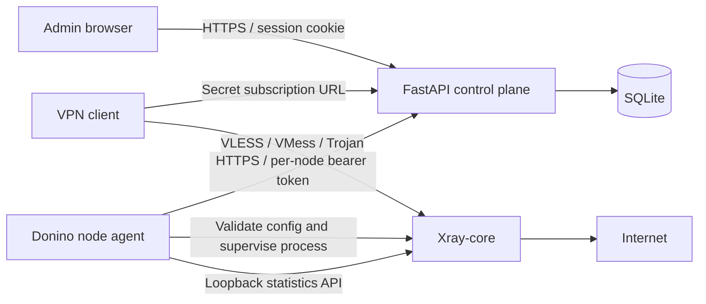

# Donino 0.1 architecture and operational boundaries

Donino is an independently implemented control plane, not a source merge of upstream panels. It uses Python/FastAPI, SQLite and a dependency-free JavaScript dashboard. Xray runs on separately enrolled nodes. All users currently belong to all enabled inbounds on all enabled nodes; selective assignments and reseller ownership are future work.

## Identity and authorization

- Admins are created locally with the CLI. Passwords use salted scrypt; opaque 12-hour session tokens are stored as SHA-256 digests. Cookies are HttpOnly, SameSite=Strict and Secure by default. Password/role changes invalidate that admin's sessions.
- Owner can manage users, nodes, inbounds, audit logs and backups. Operator manages users and subscription secrets. Viewer reads redacted user/node/inbound metadata and overview. The user record ID is distinct from its secret protocol credential, so read-only metadata is insufficient to connect.
- Mutations from the dashboard require `X-Donino: 1`, enforce matching Origin when provided, and do not enable CORS. Login attempts are limited by the actual client address (10 failures in a 15-minute window). The production proxy must overwrite forwarded headers and Uvicorn must trust only that proxy.
- A node token is returned once, stored as a digest, and only authenticates node config/heartbeat endpoints. It cannot authenticate as an admin. A node sees protocol credentials for all users assigned to it; this release assigns every user to every node. Only enroll trusted servers.
- Subscription bearer tokens and protocol credentials are stored in plaintext because the panel needs to distribute them. REALITY private keys are also stored in SQLite. Files use restrictive permissions; backups are sensitive and there is no application-level database encryption.
- Rotating a subscription token revokes the URL, not previously downloaded protocol credentials. `rotate-credentials` rotates both and changes the compiled node configs.

## Node lifecycle

Every five seconds the agent sends cumulative Xray usage counters, fetches desired config, and applies it when its SHA-256 revision changes. User eligibility is computed at fetch time from enabled flag, expiry and used/quota. REALITY server keys stay in authenticated node config; admin list responses omit private keys.

Before replacing Xray, the agent validates a candidate using `xray run -test`, attempts a final usage report, terminates the old process, atomically renames the config and starts a new process. Each Xray process has a fresh epoch. Invalid config or failed final report leaves the old process untouched. If startup fails after validation, automatic rollback is not implemented. Logs and heartbeat report failure; investigate the node. Config changes restart Xray and disconnect existing sessions. One agent/process owns fixed loopback API port 10085 on each host.

Unauthorized (401/403) panel responses stop Xray. Failure to complete a sync cycle for 120 seconds also stops it (configurable grace period, minimum 15 seconds). This release prioritizes eventual revocation over indefinite availability without the panel. Network timeouts and process shutdown time add latency to this boundary. The systemd service supervises the entire process group.

## Traffic accounting

The panel maintains high-water uplink/downlink counters per `(node, process epoch, user record ID)`. Duplicate or out-of-order reports never subtract usage or charge old bytes again. Database transactions serialize the read/modify/write step. Resetting traffic zeros the user's billed total while keeping counter baselines. Deleting a user removes its baselines; unknown users in late reports are ignored.

Counters are sampled; they are not a durable billing ledger. Bytes after the last successful snapshot may be lost during a crash or the small snapshot-to-stop interval. There is no disk queue for unsent final reports. A sudden agent/Xray crash can therefore undercount usage. Quota/expiry enforcement happens during sync, not at an exact byte or instant. UI exposes combined upload + download as consumed traffic; subscription metadata reports that combined count in the download field and zero in upload because separate lifetime totals are not stored. Usage metadata is informational.

## Data and scale

SQLite transactions are serialized with BEGIN IMMEDIATE and a busy timeout. This is a single control-plane prototype, not a high-availability database design. UI shows at most 1,000 newest users; overview computes totals across the full table. Audit view shows the last 200 events. There are no retention jobs for audit/epoch counters. High user counts, retention, pagination, PostgreSQL and schema migrations require further work.

API documentation is available at `/api/openapi.json` after admin login. No automation API key or MFA is implemented. Health endpoint only confirms app process availability, not that nodes can proxy traffic.

## Routing and protocol limits

Generated Xray configs include a loopback-only statistics API, direct egress and a block rule for private destination IPs. No arbitrary Xray JSON, remote shell execution or node command execution is exposed. REALITY targets and TLS paths are configured by the owner. The independent agent is not compatible with PasarGuard Node or Marzban Node APIs.

VLESS REALITY/TCP/Vision, VMess WebSocket/TLS and Trojan TCP/TLS were exercised with real Xray server and client processes. The local fixture test uses a temporary test certificate pinned by fingerprint and explicitly removes the private-IP block only from the fixture's config. Real configs retain that block. Tests do not establish client interoperability across all third-party applications, internet reachability, performance under load or resistance to network censorship. There is no geographic anonymity or filtering bypass guarantee.
