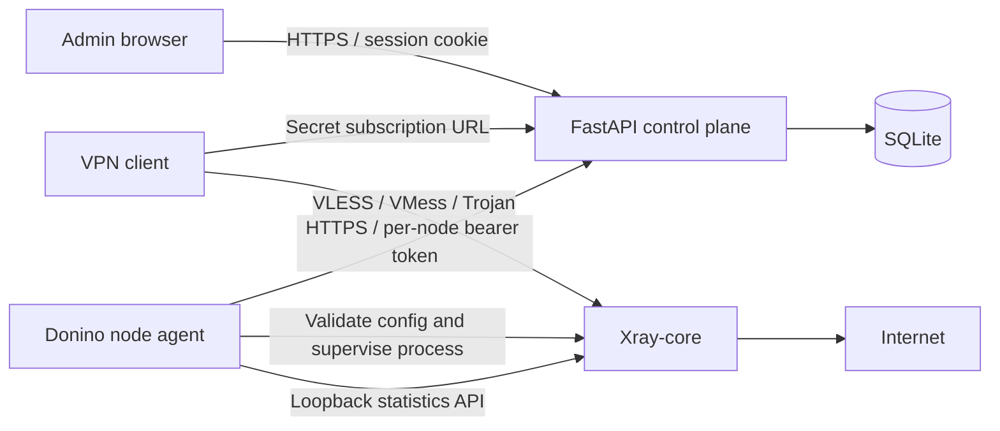

# Donino 0.2 architecture and operational boundaries

Donino is an independently implemented control plane, not a source merge of upstream panels. It uses Python/FastAPI, SQLite and a dependency-free JavaScript dashboard. Xray runs on separately enrolled nodes. All users currently belong to all enabled inbounds on all enabled nodes; selective assignments and reseller ownership are future work.

## Identity and authorization

- Admins are created locally with the CLI. Passwords use salted scrypt; opaque 12-hour session tokens are stored as SHA-256 digests. Cookies are HttpOnly, SameSite=Strict and Secure by default. Password/role changes invalidate that admin's sessions.
- Owner can manage users, nodes, inbounds, audit logs and backups. Operator manages users and subscription secrets. Viewer reads redacted user/node/inbound metadata and overview. The user record ID is distinct from its secret protocol credential, so read-only metadata is insufficient to connect.
- Mutations from the dashboard require `X-Donino: 1`, enforce matching Origin when provided, and do not enable CORS. Login attempts are limited by the actual client address (10 failures in a 15-minute window). The production proxy must overwrite forwarded headers and Uvicorn must trust only that proxy.
- A node token is returned once, stored as a digest, and only authenticates node config/heartbeat endpoints. It cannot authenticate as an admin. A node sees protocol credentials for all users assigned to it; this release assigns every user to every node. Only enroll trusted servers.
- Subscription bearer tokens and protocol credentials are stored in plaintext because the panel needs to distribute them. REALITY private keys are also stored in SQLite. Files use restrictive permissions; backups are sensitive and there is no application-level database encryption.
- Rotating a subscription token revokes the URL, not previously downloaded protocol credentials. `rotate-credentials` rotates both and changes the compiled node configs.

Schema 3 adds devices. A device is one Xray client with its own secret, and its id is the Xray email and counter key. Each user has a default device whose id equals the user id, so pre-0.3 agents and configurations keep working. Subscriptions still belong to the user and list every enabled device. Per-device subscription links are not implemented.

Administrators can enable TOTP two-factor authentication. Recovery codes are stored as digests. API tokens (`dnk_` prefix) are stored as digests, have scopes `read`, `users` and `full`, and never satisfy account-security endpoints. Sessions carry a `sid`, the creation time, the client address and the user agent, so they can be listed and revoked.

## Node lifecycle and live additions

Every five seconds the agent samples Xray counters into a local SQLite journal, flushes pending reports, fetches desired config, and applies it when its SHA-256 revision changes. User eligibility is computed at fetch time from enabled flag, expiry and used/quota. REALITY server keys stay in authenticated node config; admin list responses omit private keys.

Candidates are validated with `xray run -test`. If the complete configuration is unchanged apart from client additions, the agent uses the loopback HandlerService via `xray api adu`. It checks Xray's reported success count, because the CLI can exit zero after a partial API failure. Successful additions preserve the process, its accounting epoch and existing streams. The active config file is updated for the next full startup. A failed/partial live update falls back to a full desired-config restart.

Deleting a user from an Xray user manager does not guarantee termination of established streams. Therefore removals, disabled/expired/exhausted users, credential changes and transport/routing changes intentionally trigger a full restart. This interrupts all streams on that node to enforce revocation. The live API is not used to claim targeted session termination. See [Xray API](https://xtls.github.io/en/config/api.html) and the tested release's [VLESS user manager](https://github.com/XTLS/Xray-core/blob/v26.3.27/proxy/vless/inbound/inbound.go).

Before a restart, the agent attempts a final persisted report and stops the old process. Each new Xray process gets a fresh epoch. Invalid config or a failed final report leaves the running core untouched. If startup fails, the agent attempts to restart the previously running configuration and retains its previous revision. This rollback uses the last configuration held in memory by the current agent; it is not a cross-reboot config history. Failure of both startup and rollback stops the core. Rejected revisions are retried at most once every 30 seconds unless a different revision arrives. A restored old config is reported as an error, does not acknowledge the desired revision, and does not reset the stale timer. It can temporarily retain prior access rules until correction or the stale cutoff.

One agent owns fixed loopback API port 10085 on each host. An exclusive advisory lock prevents two agents from sharing one state directory. Run the agent with systemd so its Xray child is also terminated if the agent dies.

Unauthorized (401/403) panel responses stop Xray. Failure to complete a sync cycle for 120 seconds also stops it (configurable grace period, minimum 15 seconds). This release prioritizes eventual revocation over indefinite availability without the panel. Network timeouts and process shutdown time add latency to this boundary. The systemd service supervises the entire process group.

## Durable traffic accounting

The panel maintains high-water uplink/downlink counters per `(node, process epoch, user record ID)`. Duplicate or out-of-order reports never subtract usage or charge old bytes again. Database transactions serialize the read/modify/write step. Resetting traffic zeros the user's billed total while keeping counter baselines. Deleting a user removes its baselines; unknown users in late reports are ignored.

The node journal stores each observed cumulative snapshot before sending HTTP. Acknowledgement baselines advance only after a successful response. If the panel processes a report but its HTTP acknowledgement is lost, the same snapshot is replayed after agent restart without charging twice. Reports are split into batches of at most 500 users, with at most 20 batches per report cycle. Retired process epochs are pruned only after acknowledgement; current-epoch baselines are retained. Journal identity is bound to the authenticated node ID and panel origin. Token rotation for that node is allowed; reusing state for another node or origin is rejected before queued usage is sent. Lost state must be recovered or archived by the operator, not silently reassigned.

This protects observations committed to disk, not bytes that have never been sampled. Bytes after the final snapshot can still be lost during a crash or the snapshot-to-stop interval. Quota/expiry enforcement happens during sync, not at an exact byte or instant. Resetting usage clears reported totals; late queued usage can still arrive after a reset. This is not a financial billing ledger or a guarantee against host disk loss.

Version 0.2 stores separate uploaded/downloaded totals. Migration preserves pre-0.2 combined usage as `legacy_used`, because its historical direction is unknown. Subscription metadata assigns that legacy portion to download to preserve the previous combined total; new traffic is split correctly. Reset clears all three totals while retaining high-water baselines.

## Data and scale

SQLite transactions are serialized with BEGIN IMMEDIATE and a busy timeout. The control-plane schema uses `PRAGMA user_version=2`. The initial unversioned 0.1 schema migrates inside a transaction, after a consistent private pre-migration backup on a second connection. Backup failure aborts migration. Unknown/future schema versions are refused. Repeated startup at schema 2 does not create another migration backup.

This remains a single control-plane implementation, not a high-availability database design. UI shows at most 1,000 newest users; overview computes totals across the full table. Audit view shows the last 200 events. There is no control-plane retention job for audit/epoch counters. High user counts, pagination and PostgreSQL require further work.

API documentation is available at `/api/openapi.json` after admin login. No automation API key or MFA is implemented. Health endpoint only confirms app process availability, not that nodes can proxy traffic.

## Routing and protocol limits

Generated Xray configs include loopback-only statistics and handler APIs, direct egress and a block rule for private destination IPs. No arbitrary Xray JSON, remote shell execution or node command execution is exposed. REALITY targets and TLS paths are configured by the owner. Inbound edits preserve existing REALITY keys when the protocol remains VLESS. The independent agent is not compatible with PasarGuard Node or Marzban Node APIs.

VLESS REALITY/TCP/Vision, VMess WebSocket/TLS and Trojan TCP/TLS were exercised with real Xray server and client processes. The local fixture test uses a temporary test certificate pinned by fingerprint and explicitly removes the private-IP block only from the fixture's config. Real configs retain that block. Tests do not establish client interoperability across all third-party applications, internet reachability, performance under load or resistance to network censorship. There is no geographic anonymity or filtering bypass guarantee.

## Customer portal

`/u/{token}` and `/api/portal/{token}` use the existing subscription bearer secret; there is no separate user password or admin session. Rotating the subscription invalidates the old portal. Disabled, expired or exhausted users may still view their status using a valid token, but cannot retrieve profiles, subscription contents or QR codes. Invalid/rotated tokens return 404. QR SVGs are generated locally with python-qrcode; scripts, fonts and images stay on the same origin. No external QR or analytics service receives subscription credentials. Portal and QR responses are no-store, use no-referrer, and must be excluded from reverse-proxy access logs just like subscription URLs.
