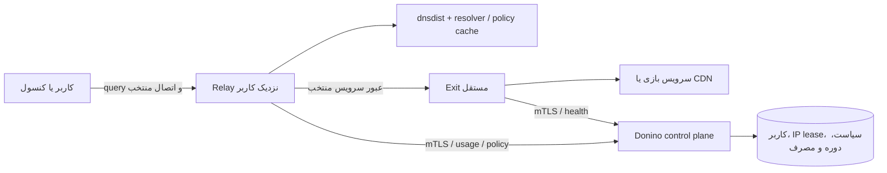

# طراحی Donino DNS و Gaming DNS

وضعیت: طراحی فازهای ۴ و ۵؛ در Donino 0.2 وجود ندارد. منابع بررسی‌شده: [doctor-dns در SHA ثابت](https://github.com/danialrad04-sketch/doctor-dns/tree/a2b2ff843cb1fc8f0a5712a88149f5c379198ff1)، [Unbound](https://unbound.docs.nlnetlabs.nl/en/latest/)، [dnsdist](https://www.dnsdist.org/) و [ماتریس پروتکل](PROTOCOL-MATRIX.fa.md). این طراحی، رفع ایراد یا اجرای موفق کد doctor-dns را ادعا نمی‌کند.

## سه محصول و معنای مصرف

| خدمت | چه چیزی عبور می‌کند؟ | هویت و حسابداری | کاربرد و محدودیت |
|---|---|---|---|
| Donino DNS | query/response نام دامنه | درخواست، بایت DNS و IP/هویت احرازشده | DNS عادی یا رمزگذاری‌شده؛ ترافیک مستقیم بازی از سرور عبور نمی‌کند و قابل محاسبه به‌عنوان حجم بازی نیست |
| Donino Smart DNS | DNS + اتصال سرویس منتخب از relay/exit | IP lease؛ ارسال/دریافت در مرز کلاینت relay | ورود/فروشگاه/دانلود انتخابی؛ SNI، مسیر CDN، QUIC و ECH می‌توانند محدودیت ایجاد کنند |
| Donino Gaming Tunnel | مسیر واقعی ترافیک کلاینت | peer/session پروتکل VPN | برای UDP بازی و سناریوی نیازمند تونل؛ کلاینت یا روتر سازگار لازم است |

تنظیم DNS در کنسول، کنسول را به WireGuard/OpenVPN تبدیل نمی‌کند. حالت تونل برای کنسول بدون کلاینت باید روی روتر/دروازهٔ سازگار راه‌اندازی شود. پینگ به مسیر و ISP وابسته است؛ موفقیت DNS یا دانلود به معنی موفقیت بازی آنلاین نیست.

## توپولوژی و نقش‌ها

resolver بازگشتی هدف Unbound و لبهٔ DNS هدف dnsdist است؛ قابلیت DoQ/DoH3 به build/version وابسته است. در فاز ۴ این نسخه‌ها با checksum و تست قفل می‌شوند. موتور resolver doctor-dns و فایل‌های اجرایی آن بدون adapter وارد Donino نمی‌شوند. Roleهای control/relay/exit روی یک سرور هم قابل طراحی‌اند، اما installer باید پیش از تغییر، مالکیت پورت را قطعی کند.

### جریان درخواست

۱. مجوز از credential یا IP lease معتبر پیدا می‌شود؛ IP باید از اتصال واقعی یا proxy مورد اعتماد استخراج شود، نه header دلخواه کاربر.

۲. entitlement فعال، انقضا، بودجه و policy بررسی می‌شود. درخواست بدون مجوز روی resolver/relay عمومی پذیرفته نمی‌شود؛ کنترل نرخ و ACL از تبدیل سرویس به resolver یا proxy باز جلوگیری می‌کند.

۳. policy تعیین می‌کند دامنه direct، block یا routed باشد. cache براساس policy و پاسخ بازنویسی‌شده ایزوله می‌شود؛ پاسخ مشترک نباید سیاست یک مشتری را به مشتری دیگر نشت دهد.

۴. پاسخ واقعی DNSSEC اعتبارسنجی می‌شود؛ پاسخ ساخته/بازنویسی‌شده نباید به‌دروغ AD معتبر داشته باشد. رفتار AD/CD، خطای validation و استثنای دامنه در policy مستند می‌شود.

۵. اتصال منتخب تنها به سرویس/مقصد مجاز هدایت می‌شود. SNI passthrough به معنی رمزگشایی TLS نیست؛ گواهی سرویس مقصد جعل نمی‌شود. دامنه/SNI نامعتبر، IP خصوصی و مقصد خارج از کاتالوگ بدون سیاست مجاز پذیرفته نمی‌شود.

۶. نمونه مصرف ثبت پایدار و سپس ارسال می‌شود. downstream و upstream روی مرز client-facing شارژ می‌شوند؛ relay→exit دوباره از حجم کاربر کسر نمی‌شود.

## کنترل دسترسی و هویت

- `SourceIPLease` شامل مالک، IP/خانواده، زمان اثبات، شروع/پایان، حداکثر تعداد IP و نسخه سیاست است. IP جدید باید با درخواست از همان IP و حساب احرازشده یا روش اثبات معتبر ثبت شود؛ ثبت IP دلخواه بدون اثبات مجاز نیست.
- ACL از اولین نصب بسته است. management/SSH مسیر مستقل دارد؛ خالی‌بودن allowlist علت بازگذاشتن سرویس نیست. تغییر ACL اتمی، نسخه‌دار و قابل بازگشت است؛ جدول‌های متعلق به Donino تغییر می‌کنند، نه کل ruleset میزبان.
- IP عمومی مشترک/CGNAT به‌تنهایی دو مشتری را از هم تشخیص نمی‌دهد. سیاست تعارض باید یا مالکیت مشترک صریح باشد یا ثبت دوم رد شود؛ حجم مستقل قطعی از یک IP مشترک ادعا نمی‌شود. پیشنهاد جایگزین، credential رمزگذاری‌شده یا تونل دستگاه است.
- DoH فقط با کلاینت پشتیبان، امکان credential مناسب می‌دهد. توکن URL اگر لازم باشد در access log، referrer و metrics ثبت نشود؛ چرخش و انقضا داشته باشد. برای DoT/DoQ هدر HTTP فرض نمی‌شود؛ ACL، mTLS سازگار یا روش خود موتور باید آزموده شود.
- محدودیت نرخ، سقف اتصال، اندازه پاسخ و مصرف منابع برای IP/هویت تعیین می‌شود. DoH ورودی باید مقصد resolver ثابت داشته باشد؛ URL دلخواه upstream از کاربر پذیرفته نشود.

## کاتالوگ سرویس و کیفیت

هر template دارای شناسه و نسخه، دامنه‌های دقیق/پسوند مجاز، مسیر CNAME/CDN، IPv4/IPv6، policy، health probe، تاریخ آخرین آزمون و rollback است. دامنه‌های جدید تنها با بازبینی و آزمون وارد کاتالوگ شوند؛ فهرست قدیمی doctor-dns تضمین پوشش جاری تمام CDNها نیست.

| خانواده هدف | سناریوهای مستقلِ آزمون |
|---|---|
| PlayStation/PSN و Xbox | ورود، فروشگاه، دانلود/بروزرسانی، matchmaking، gameplay |
| Steam و Epic | احراز هویت، فروشگاه، دانلود CDN، launcher و بازی منتخب |
| EA، Riot و Battle.net | launcher، ورود، patch، منطقه و بازی منتخب |

نتیجه برای هر ISP/کشور مسیر/نسخه کلاینت جدا ثبت شود. شاخص‌ها: زمان resolve با cache سرد/گرم، موفقیت ورود/دانلود، throughput، latency، jitter و packet loss. baseline همان زمان با مسیر مستقیم و سپس مسیر خدمت مقایسه شود؛ رتبه‌بندی یا وعده کاهش پینگ بدون شاهد مجاز نیست. STUN/TURN به‌تنهایی تمام UDP یک بازی را تونل نمی‌کند. در ECH، SNI ناخوانا یا QUIC ناسازگار، سرویس باید محدودیت را نشان دهد یا مسیر تونلِ واقعاً پشتیبانی‌شده پیشنهاد کند.

IPv6 نباید مسیر bypass ناخواسته بسازد: AAAA/CNAME و dual-stack در آزمون وجود دارند. غیرفعال‌سازی IPv6 فقط به‌عنوان حالت صریح با توضیح به کاربر مجاز است. NXDOMAIN، پاسخ truncated، TCP fallback، timeout، SERVFAIL و تغییر IP exit باید سناریوی آزمون داشته باشند.

## حسابداری و دوره‌ها

شناسه منطقی مصرف Smart DNS: `(relay_id, counter_generation, source_ip_lease_id, usage_period_id)` با شمارنده تجمعی ارسال/دریافت. نصب مجدد rule یا reboot نسل جدید می‌سازد. IP نباید پس از تغییر مالک، بایت‌های باقی‌مانده مالک قدیم را به مالک جدید منتقل کند. flush/restore شمارنده nftables بدون snapshot و مرز نسل مجاز نیست.

DNS-only، Smart DNS و تونل ledgerهای جدا با واحد مشخص دارند. داشبورد می‌تواند جمع قابل توضیح نمایش دهد، اما DNS query count با بایت جمع نمی‌شود. پهنای باند doctor-dns فعلاً دانلودمحور است؛ Donino تنها پس از آزمون shaping دوطرفه ادعای محدودیت upload/download جدا می‌کند. بودجه مشترک و رفتار آفلاین از [MASTER-PLAN](MASTER-PLAN.fa.md) پیروی می‌کنند؛ relay با lease منقضی باید سرویس حفاظت‌شده را ببندد.

## مهاجرت doctor-dns

منبع fork متعلق به حساب کاربر و upstream آن `mehdi047/doctor-dns` است. مجوز MIT با copyright اصلی باید در هر کپی کد یا بخش عمده آن حفظ و در فهرست third-party ثبت شود. این فاز فقط کد و مستند را خوانده است؛ هیچ نصب‌کنندهٔ منبع اجرا نشده است. دادهٔ production نباید برای تحلیل در log یا مخزن بارگذاری شود.

| داده منبع | نگاشت هدف | کنترل قبل از انتقال |
|---|---|---|
| users، شناسه و وضعیت | User + ExternalIdentity | جدول mapping پایدار؛ ایجاد دوباره حساب در retry ممنوع |
| password_hash/salt | credential مهاجرتی یا reset امن | الگوریتم دقیق بررسی؛ hash با قالب ناآشنا بی‌صدا پذیرفته نشود |
| quota/used/quota_mode/reset_at | Entitlement + UsagePeriod | واحد بایت، unlimited، monthly/oneoff و timezone تطبیق داده شود |
| expires_at | انقضای entitlement | تاریخ مبهم با خطای قابل رفع متوقف شود |
| ips و سقف تعداد | SourceIPLease | مالک، تعارض، IPv6، اثبات IP و تاریخ انقضا |
| services.json و templateها | DNSPolicy + ServiceTemplate | schema، دامنه، مسیر و نسخه؛ کد یا shell قالب اجرا نشود |
| سرعت دانلود | سیاست shaping محدود | واحد kbps و دامنه جهت انتقال حفظ شود |
| wallet/transactions/receipts | دفتر legacy یا import مستقل فاز ۱۲ | واحد پول و مانده تطبیق؛ پرداخت زنده دوباره اجرا نشود |
| counter/state و کلیدهای سرویس | baseline و secret storage | حفظ مرز مصرف و چرخش کنترل‌شده؛ نمایش‌ندادن کلید در گزارش |

روند انتقال: snapshot سازگار و خصوصی → dry-run خواندنی با گزارش حذف‌شده از داده حساس → نگاشت و بررسی تعارض → توقف کوتاه تغییر/مصرف و snapshot نهایی → import تراکنشی → مقایسه تعداد/حجم/انقضا → canary یک relay → پذیرش → جابه‌جایی نقش‌ها. در دوره هم‌زیستی، فقط یک مالک برای write حساب و مصرف وجود دارد. بازگشت باید DB، mapping، ACL و مرز شمارنده متناظر را با هم برگرداند؛ تغییر DNS با TTL و cache واقعی سنجیده شود.

## محدودیت‌های شناخته‌شده و شرط تحویل

README منبع توقف دانلود Xbox را حل‌نشده اعلام می‌کند. این مورد تا اتصال و دانلود واقعی در شبکهٔ هدف موفق نشود در Donino هم رفع‌شده نامیده نمی‌شود. مسیر تمدید گواهی منبع موقتاً پورت ۸۰ را به challenge می‌برد و می‌تواند دانلود را مختل کند؛ Donino طبق [INSTALLER-SPEC](INSTALLER-SPEC.fa.md) role/port مستقل یا روش challenge سازگار می‌خواهد.

تحویل فاز ۴: DNS-01/02. تحویل فاز ۵: DNS-03/04/05 و سناریوی نصب/تمدید گواهی در حضور relay. اگر یک سرویس بازی آزمون واقعی ندارد، وضعیت آن «آزمایشی/آزموده‌نشده» باقی می‌ماند؛ بقیه سرویس‌های پذیرفته‌شده می‌توانند مستقل منتشر شوند.

## پیاده‌سازی انتخاب‌شده در alpha 11

[Smart DNS فعلی](SMART-DNS.fa.md) به‌جای شمارندهٔ nftables پیشنهادیِ طرح، از gateway برنامه برای رزرو اتمیک بایت TLS پیش از write استفاده می‌کند. شناسهٔ نشست و دورهٔ تغییرناپذیر، revision سیاست/خروجی و lease مالکیت IP مرز انتساب‌اند؛ quota هر دو جهت از DNS/VPN مستقل است. این انتخاب، اختیار مقصد و کنترل حجم را بدون تغییر firewall میزبان در برش HTTPS فراهم می‌کند. شمارندهٔ سیم/UDP و shaping شبکه هنوز پیاده نشده‌اند؛ اضافه‌شدن آن‌ها نیازمند نسل/تطبیق مستقل مطابق طرح است. این برش گواهی مقصد مشتری را terminate نمی‌کند؛ لینک gateway→exit گواهی مستقلِ بررسی‌شده دارد.
