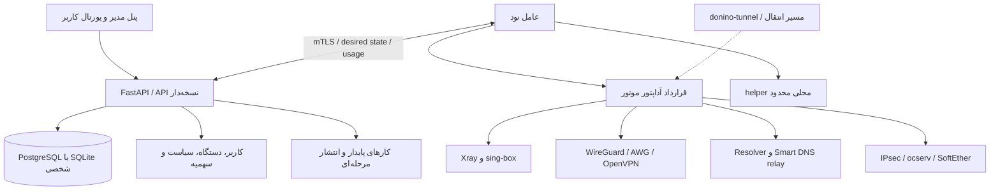

# برنامهٔ جامع Donino Panel 1.0

نسخهٔ سند: ۱ — تاریخ: ۲۰۲۶-۱۰-۱۵ — مبنای محصول: [`v0.2.0`](https://github.com/danialrad04-sketch/donino-panel/tree/fa9fe95a3b477249a27a55983ffbe514adc0279d).

این سند قرارداد اجرای توسعه است. قابلیت‌های هدف هنوز پیاده‌سازی نشده‌اند؛ وضعیت واقعی در [ماتریس امکانات](FEATURE-PARITY.fa.md) آمده است. بوم MagicPath با شناسهٔ `461556009694015488` نمای بصری این برنامه است؛ این شش سند نسخه‌پذیر مرجع اجرای آن هستند. تغییر دامنه باید هم‌زمان در سند مرتبط و وضعیت قابلیت ثبت شود.

## هدف و مرز محصول

Donino یک مرکز مستقل مدیریت کاربر، دستگاه، VPN، پروکسی و DNS گیمینگ می‌شود. مدل کاربر و سهمیه مشترک است، اما اجرای پروتکل به موتور مناسب سپرده می‌شود. رمزنگاری جدید یا ترکیب مستقیم فایل‌های پنل‌های ناسازگار، روش اجرای این برنامه نیست.

«پشتیبانی کامل» یعنی ساخت، اعتبارسنجی، اتصال کلاینت واقعی، عبور داده، حسابداری، اعمال حجم و انقضا، قطع نشست فعال، راه‌اندازی مجدد و بازیابی آزموده شوند. نام یک پروتکل در موتور به‌تنهایی گواه پشتیبانی محصول نیست. سازگاری با همهٔ پروتکل‌ها و تمام کلاینت‌های جهان قابل تضمین نیست؛ [ماتریس پروتکل](PROTOCOL-MATRIX.fa.md) محدودهٔ قابل اثبات را تعیین می‌کند.

اولویت: **زیرساخت و نصب → DNS گیمینگ → WireGuard/OpenVPN → تنوع پروتکل و مسیر → مدیریت تکمیلی و نسخهٔ پایدار**. ظاهر رابط و پورتال در هر مرحله همراه همان قابلیت توسعه می‌یابد؛ فاز ۱۳ یکپارچه‌سازی و تکمیل تجربه است.

## اسناد اجرایی

| سند | تصمیم و خروجی |
|---|---|
| [FEATURE-PARITY](FEATURE-PARITY.fa.md) | امکانات مرجع، وضعیت Donino، فاز و شرط برابری |
| [PROTOCOL-MATRIX](PROTOCOL-MATRIX.fa.md) | نقش موتور، حسابداری، ابطال، خروجی و بلوغ هر پروتکل |
| [DNS-GAMING-DESIGN](DNS-GAMING-DESIGN.fa.md) | سه محصول DNS، مدل ACL، حجم و انتقال doctor-dns |
| [INSTALLER-SPEC](INSTALLER-SPEC.fa.md) | نصب، دامنه و SSL، پورت، ارتقا و بازیابی |
| [ACCEPTANCE-TESTS](ACCEPTANCE-TESTS.fa.md) | سناریوها، حد پذیرش و مدارک لازم برای انتشار |

## تصمیم‌های معماری

| شناسه | تصمیم پایه | دلیل و پیامد |
|---|---|---|
| ADR-01 | کنترل‌پلین FastAPI ماژولار؛ عامل جدا از پنل | حفظ پایهٔ موجود و امکان افزودن موتور بدون بازنویسی کل محصول |
| ADR-02 | PostgreSQL پیش‌فرض حرفه‌ای؛ SQLite حالت شخصی؛ SQLAlchemy/Alembic | یک مدل منطقی، مهاجرت نسخه‌دار، آزمون هر دو backend؛ SQLite به‌معنی HA نیست |
| ADR-03 | موتورهای مستقل پشت قرارداد قابلیت | پیکربندی، اعتبارنامه، حسابداری و قطع دسترسی در Xray، WireGuard و OpenVPN یکسان نیستند |
| ADR-04 | اعتبارنامهٔ مستقل هر دستگاه/پروتکل و تخصیص انتخابی نود | محدودکردن دامنهٔ افشای کلید و امکان لغو یک دستگاه |
| ADR-05 | ثبت اولیهٔ کوتاه‌عمر نود و سپس mTLS؛ root helper محلی با عملیات محدود | چرخش و لغو هویت نود؛ بدون shell عمومی یا اجرای متن فرمان دلخواه |
| ADR-06 | سهمیه با دفتر مصرف پایدار و بودجهٔ محدودِ اجاره‌ای نود | جلوگیری از تخصیص چندبارهٔ مانده در چند نود؛ تحمل قطع شبکه با محدودیت معلوم |
| ADR-07 | صف کار پایدار در DB در شروع؛ Redis/NATS فقط با اندازه‌گیری نیاز | کاهش اجزای الزامی نصب؛ اجرای کار باید idempotent و دارای lease باشد |
| ADR-08 | NGINX و ACME، با دفتر پورت و نقش‌های control/relay/exit | امکان نصب ساده و جلوگیری از تعارض SSL، Smart DNS و پروتکل‌های UDP |
| ADR-09 | API نسخه‌دار و UI فارسی RTL/انگلیسی؛ توسعهٔ تدریجی رابط فعلی | انتخاب React/TypeScript نیازمند تصمیم جدا با برآورد مهاجرت است؛ پیش‌شرط موتور جدید نیست |
| ADR-10 | کد Donino مستقل؛ استفادهٔ احتمالی از منبع با ثبت منشأ و مجوز | MIT مربوط به doctor-dns حفظ می‌شود؛ متادیتای GitHub مجوز قطعی بازاستفاده نیست |

## داده، حسابداری و سازگاری

مدل منطقی هدف: `User → Device → Credential`؛ `Plan → Entitlement → UsagePeriod`؛ `Node → Engine → Endpoint`؛ `Assignment` اتصال مجوز به نود/endpoint را مشخص می‌کند. `DNSPolicy` و `SourceIPLease` برای DNS، و `Certificate`، `Job`، `Payment` و `Audit` برای عملیات و تجارت جدا هستند. `UsageSample` به نود، اعتبارنامه، نسل شمارنده و دوره مصرف متصل می‌شود. این‌ها طراحی هستند، نه جدول‌های موجود v0.2.

- زمان ذخیره‌سازی UTC و نمایش شمسی/محلی در UI؛ حجم عدد صحیح بایت است. مقدار نامحدود باید صریح باشد و با سهمیهٔ صفر اشتباه نشود. معنای صفر در دادهٔ قدیمی هنگام مهاجرت حفظ می‌شود.
- رویداد مصرف تجمعی و قابل تکرار است؛ کلید یکتا شامل نود، نسل شمارنده و اعتبارنامه/peer/session می‌شود. تغییر دوره یا reset، نسل دوره را عوض می‌کند؛ گزارش دیررس دورهٔ قبلی نباید دورهٔ جدید را مصرف کند.
- جمع بودجه‌های تخصیص‌یافته از ماندهٔ قابل تخصیص بیشتر نمی‌شود. TTL، سقف بودجه و حداکثر نرخ مجاز در سیاست ثبت می‌شوند. نود آفلاین فقط تا زودترین حدِ انقضا، پایان بودجه یا پایان lease مجاز است.
- نبود حد نرخ، ادعای حد قطعی اضافه‌مصرف برحسب بایت را نامعتبر می‌کند. پنجرهٔ نمونه‌برداری/توقف و بایت‌های ثبت‌نشده در خرابی باید در گزارش ظرفیت و SLO ثبت شوند.
- مهاجرت از v0.2 باید شناسه‌ها، توکن‌ها، کلیدها، انقضا، `legacy_used` و شمارنده‌های فعلی را حفظ کند؛ بازنویسی یا حدس‌زدن جهت مصرف قدیمی ممنوع است. rollback کد روی schema ناسازگار مجاز نیست؛ DB و config متناظر بازیابی می‌شوند.
- ایندکس، pagination و retention براساس مسیرهای کاربر/دوره/نود طراحی شوند. Timescale، HA و چند کنترل‌پلین پس از نیازسنجی و آزمون مستقل وارد می‌شوند.

## نقشهٔ راه و وابستگی‌ها

«پیش‌نیاز» یعنی تکمیل قرارداد یا پذیرش آن مرحله؛ طراحی UI و تحقیق می‌توانند هم‌زمان با توسعه پیش بروند. نقش‌های جدول مسئولیت فنی‌اند؛ تا تعیین اعضای تیم، مسئول هماهنگی همان نگهدارندهٔ Donino است.

| فاز | پیش‌نیاز | خروجی مشخص | مسئول فنی | دروازهٔ پذیرش |
|---|---|---|---|---|
| ۰ — مبنا | v0.2 | همین شش سند، مرجع SHAدار، دامنه و تصمیم‌های معماری | معماری | DOC-01 و DOC-02 |
| ۱ — داده و امنیت | ۰ | DB حرفه‌ای، migration، device credential، RBAC/MFA | backend | DATA-01، SEC-01 |
| ۲ — نصب و گواهی | ۱ | installer، SSL، doctor، backup/restore | عملیات | INST-01 تا INST-04 |
| ۳ — SDK و نود | ۱، ۲ | mTLS، job پایدار، adapter contract، سهمیهٔ مشترک | شبکه/backend | NODE-01، USAGE-01 تا USAGE-03 |
| ۴ — resolver | ۳ | DNS پایه و رمزگذاری‌شده، سیاست و cache جدا | DNS | DNS-01، DNS-02 |
| ۵ — gaming DNS | ۴ | relay/exit، کاتالوگ سرویس و importer doctor-dns | DNS/شبکه | DNS-03 تا DNS-05 |
| ۶ — WireGuard/AWG | ۳؛ بعد از ۵ در اولویت تحویل | peer/device، profile/QR و اعمال سهمیه | شبکه | PROTO-01 برای هر دو موتور |
| ۷ — OpenVPN | ۳، ۶ برای الگوی دستگاه | CA، گواهی و مدیریت نشست UDP/TCP | شبکه | PROTO-01 و SEC-02 |
| ۸ — Xray کامل‌تر | ۳ | Shadowsocks و ترکیب‌های منتخب انتقال، routing/fallback | شبکه | PROTO-01، COMPAT-01 |
| ۹ — sing-box | ۳، ۸ برای قرارداد خروجی | Hysteria2/TUIC/AnyTLS و پروتکل‌های مشروط | شبکه | PROTO-01، COMPAT-01 |
| ۱۰ — مسیر و تونل | ۸، ۹ | خروجی، chain، failover، LB و اتصال donino-tunnel | شبکه | ROUTE-01 |
| ۱۱ — VPN سازمانی | ۳، ۷ | IKEv2، OpenConnect، SoftEther با پروفایل مستقل | شبکه | PROTO-01 برای هر خانواده |
| ۱۲ — مدیریت و فروش | ۱، ۳؛ ترتیب پس از ۱۱ | نماینده، بودجه، پلن، پرداخت، اعلان | backend | BIZ-01، SEC-01 |
| ۱۳ — تجربه و کانفیگ | قابلیت‌های فازهای قبل | سازنده یکپارچه، خروجی کلاینت، importer و UI کامل | frontend/شبکه | UI-01، COMPAT-01، IMPORT-01 |
| ۱۴ — پایدارسازی ۱.۰ | همهٔ قابلیت‌های داخل انتشار | ظرفیت، مانیتورینگ، بازیابی، راهنمای عملیات و release | نگهدارنده/QA | OPS-01، RELEASE-01 |

پروتکل‌های HTTP/SOCKS/Mixed در فاز ۸، MTProto با آداپتور مجزا در فاز ۹ ارزیابی می‌شوند. DoH3 در فاز ۴ فقط با موتورِ آزموده‌شده؛ DNSCrypt و overlayهای Headscale/NetBird پس از ۱.۰ قرار دارند. انتقال یک مورد از آینده به ۱.۰ مستلزم اصلاح ماتریس، وابستگی و آزمون همان مورد است.

## روش اجرا و برآورد

هر فاز به issueهای دارای شناسهٔ قابلیت، خروجی قابل بررسی، مهاجرت/بازگشت، آزمون و مستند شکسته می‌شود. شاخه و PR کوچک باشند؛ تغییر موتور، حسابداری و UI در یک ادغام بی‌مرز جمع نشوند. یک قابلیت از «طراحی» به «در توسعه»، «آزمایشی»، «پذیرفته» و «پایدار» می‌رود. مدارک پذیرش باید به SHA کد متصل باشند؛ عکس رابط یا تست mock جای اتصال واقعی نیست.

برآورد اولیهٔ پیچیدگی: فازهای ۱، ۳، ۵، ۱۰ و ۱۱ زیاد؛ فازهای ۲، ۴، ۶ تا ۹، ۱۲ تا ۱۴ متوسط تا زیاد. این رتبه، وعدهٔ زمان یا قیمت نیست. پیش از شروع هر فاز، قراردادها به کارهای قابل برآورد شکسته و دامنهٔ انتشار بسته می‌شود. اولین برش اجرایی فاز ۱: مدل credential/device، migration آزمایشی SQLite→PostgreSQL و حفظ هویت/مصرف؛ سپس RBAC/MFA.

## ریسک و تصمیم‌های هنگام پیاده‌سازی

| موضوع | اقدام و زمان تصمیم |
|---|---|
| نسخهٔ موتورهای جدید و تفاوت قابلیت‌ها | شبکه پیش از شروع هر adapter، نسخه/معماری/checksum و کلاینت را قفل می‌کند؛ تا آن زمان «هدف» باقی می‌مانند |
| Linux و معماری installer | خط هدف: Ubuntu 24.04 LTS و Debian 12، amd64؛ arm64 پس از asset و VM واقعی؛ اعلام پشتیبانی فقط پس از INST-01 |
| پینگ و بازی/ISP | آزمون شاهد روی شبکه واقعی؛ نتیجه برای هر سرویس/ISP/سناریو جدا، بدون تضمین همگانی |
| گواهی و دامنه | DNS صحیح پیش‌شرط؛ API ارائه‌دهنده اختیاری؛ مسیر HTTP-01 با نقش relay تداخل نکند |
| مجوز منبع و وابستگی | نگهدارنده پیش از انتقال هر فایل بررسی می‌کند؛ ابهام مجوز مانع بازاستفادهٔ کد همان منبع است، نه طراحی مستقل قابلیت |
| پرداخت و منطقه زمانی | ارز، واحد پول و ارائه‌دهنده در فاز ۱۲ انتخاب می‌شوند؛ انتقال پول/کیف پول قدیمی بدون تطبیق واحد مجاز نیست |
| زیرساخت عملیاتی | VPS، دامنه، اعتبارنامه DNS و درگاه در این مرحله لازم نیست؛ برای پذیرش واقعی همان قابلیت فراهم می‌شوند |

## پایان فاز صفر

پذیرش این فاز یعنی اسناد قابل پیگیری، دامنهٔ فعلی/هدف مشخص، منابع نسخه‌دار و تست‌های آینده تعریف شده‌اند. به معنی اجرای آن تست‌ها، رفع ایرادهای doctor-dns، صدور SSL یا آماده‌بودن Donino 1.0 نیست. نتایج محصول موجود در [VALIDATION](VALIDATION.md) و نتایج اجرای آتی در [قالب مدرک پذیرش](ACCEPTANCE-TESTS.fa.md#قالب-مدرک-پذیرش) ثبت می‌شوند.
